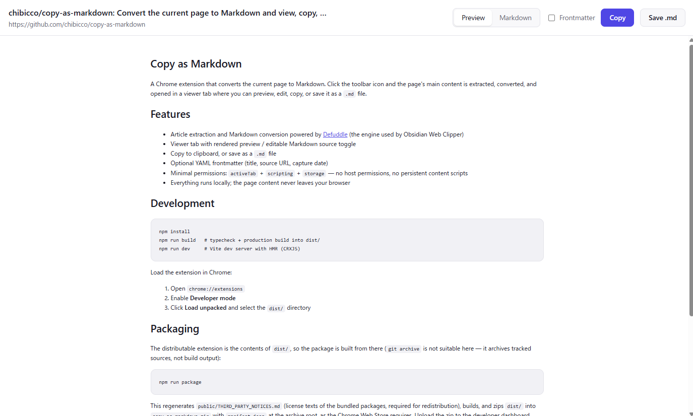
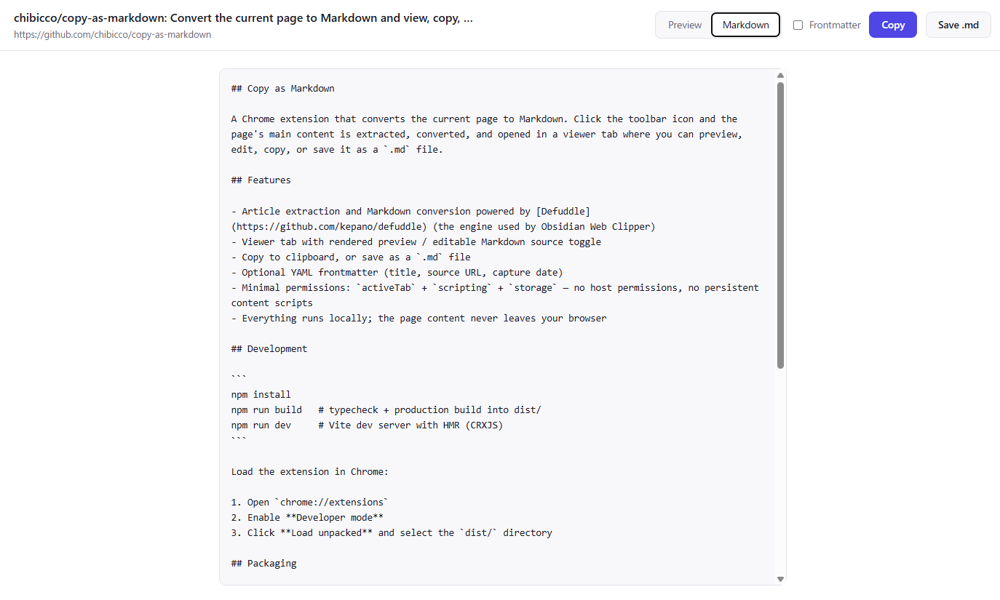

# Copy as Markdown

A Chrome extension that converts the current page to Markdown. Click the
toolbar icon and the page's main content is extracted, converted, and opened
in a viewer tab where you can preview, edit, copy, or save it as a `.md` file.

## Screenshots

Rendered preview of the captured page:



The same capture as editable Markdown source:



## Features

- Article extraction and Markdown conversion powered by
  [Defuddle](https://github.com/kepano/defuddle) (the engine used by Obsidian
  Web Clipper)
- Viewer tab with rendered preview / editable Markdown source toggle
- Copy to clipboard, or save as a `.md` file
- Optional YAML frontmatter (title, source URL, capture date)
- Minimal permissions: `activeTab` + `scripting` + `storage` — no host
  permissions, no persistent content scripts
- Everything runs locally; the page content never leaves your browser

## Development

```sh
npm install
npm run build   # typecheck + production build into dist/
npm run dev     # Vite dev server with HMR (CRXJS)
```

Load the extension in Chrome:

1. Open `chrome://extensions`
2. Enable **Developer mode**
3. Click **Load unpacked** and select the `dist/` directory

## Packaging

The distributable extension is the contents of `dist/`, so the package is
built from there (`git archive` is not suitable here — it archives tracked
sources, not build output):

```sh
npm run package
```

This regenerates `public/THIRD_PARTY_NOTICES.md` (license texts of the
bundled packages, required for redistribution), builds, and zips `dist/`
into `copy-as-markdown.zip` with `manifest.json` at the archive root, as
the Chrome Web Store requires. Upload the zip to the developer dashboard.

## How it works

- `src/background.ts` — service worker. On toolbar click it injects the
  extract script into the active tab (`activeTab` grants temporary access),
  validates the returned payload, stashes it in `chrome.storage.session`,
  and opens the viewer tab.
- `src/extract.ts` — injected into the page on demand. Runs Defuddle with
  `markdown: true` and sends the result back.
- `src/viewer/` — the viewer page. Renders a sanitized preview
  (marked + DOMPurify) and handles copy / download.

Icons are generated deterministically with `node scripts/generate-icons.mjs`
(no image dependencies).
